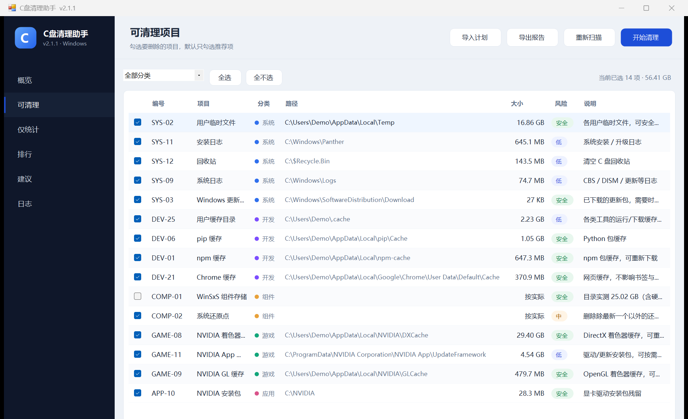

# C Drive Cleaner

[中文文档](README.zh-CN.md) · [Detailed manual (中文)](docs/使用说明.md)

A portable Windows GUI that analyses what is actually using your C: drive, shows a
categorised cleanup list, and only deletes what you explicitly approve.

Written in C# (WinForms), compiled with the .NET Framework compiler that ships with
Windows — one ~130 KB executable, no installer, no runtime to download, no telemetry.



> ### ⚠️ Read this first
> This program **permanently deletes files**. Deleted data does not go to the Recycle Bin
> and cannot be recovered by the program.
>
> - Start with the **dry-run** option (确认框中的「仅演练」) and read the list.
> - It asks for administrator rights because system caches live in protected folders.
> - It is provided **as is**, without warranty. You are responsible for what you delete.
> - The source is small and readable on purpose — review it before running it elevated.

---

## Highlights

- **Real disk analysis** — walks every directory on C:, aggregates sizes per folder
  (depth 1–4), ranks the largest files, and reports hard-link-aware numbers.
- **76 curated cleanup targets** in six categories: system junk, developer caches,
  Windows components (DISM / restore points), GPU & game shaders, third-party app caches,
  and user data (report-only).
- **Nothing personal is deleted** — WeChat/QQ/DingTalk data, Downloads, Desktop, Documents,
  videos, game libraries and Docker images are measured but never offered for deletion.
- **Whitelist-validated deletion** — every path is checked before anything is removed;
  a single unsafe path aborts the whole run. Junctions and symlinks are never followed.
- **Dry run** — rehearse the exact operation without deleting a byte.
- **Full audit log** — every item and every file that could not be deleted is written to
  `Documents\C盘清理助手\C-Clean-Log-*.log`.
- **Minimal network** — at most one HTTPS request per day to GitHub Releases, only to check
  for a newer version. No telemetry, no ads, no automatic download or install. Can be
  disabled in settings or with `--no-update-check`.

## Requirements

| | |
|---|---|
| OS | Windows 10 1809+ / Windows 11 (x64) |
| Runtime | .NET Framework 4.8 (built into Windows 10 1903+ and Windows 11) |
| Privileges | Administrator (the app re-launches itself through UAC) |
| Disk | any |

## Quick start

### Download

Grab the latest files from [Releases](../../releases):

| File | What it is |
|------|------------|
| `c-drive-cleaner-2.0.1-setup.exe` | **Installer** — per-user install (no admin needed), Start Menu entry, optional desktop shortcut, standard uninstaller in *Apps & features*. |
| `c-drive-cleaner-2.0.1-portable.zip` | **Portable** — just the EXE, the manual and the license. Unzip anywhere and run. |
| `SHA256SUMS.txt` | Checksums for both files. |

The installer is unsigned, so SmartScreen may show *"Windows protected your PC"* —
choose **More info → Run anyway**.

### Build from source

No Visual Studio, no .NET SDK — the build uses the `csc.exe` that ships with Windows.

```powershell
git clone https://github.com/Misaka-11736/c-drive-cleaner.git
cd c-drive-cleaner
powershell -ExecutionPolicy Bypass -File .\build.ps1
```

Output: `.\C盘清理助手.exe` (about 130 KB). You can also pass `-Out <path>`.

To reproduce the release assets (app + installer + portable ZIP + checksums):

```powershell
powershell -ExecutionPolicy Bypass -File .\build-release.ps1 -Version 2.0.1
```

### Run

1. Double-click the installed shortcut or the portable executable → approve the UAC prompt.
2. Click **重新扫描 / Rescan** (F5). The scan is read-only and takes ~90 s on a typical SSD.
3. Go to **可清理 / Cleanable**, review the checked items (only recommended ones are
   checked by default), and click **开始清理 / Clean**.
4. In the confirmation dialog, type `DELETE` to unlock the button — or tick
   **仅演练 (dry run)** to rehearse without deleting.
5. The result and the full log appear on the **日志 / Log** page.

The installer does **not** need administrator rights. Only the cleanup itself elevates.

## How it works

1. **Scan** — resolves the 76 target patterns (including wildcards such as
   `C:\Users\*\AppData\Local\Temp`), walks `C:\` once, and attributes file sizes to the
   matching target. Folder totals are aggregated for depths 1–4; files ≥ 50 MB are ranked.
2. **Review** — the GUI shows per-category totals, risk badges, file counts and notes.
   Report-only items (personal data) are listed separately and cannot be selected.
3. **Delete** — after a `DELETE` confirmation, each selected target is removed
   (`contents` keeps the folder itself). Read-only attributes are cleared; locked files are
   skipped and logged. DISM, restore points and the Recycle Bin use their native APIs.

## Safety model

- Every deletion path passes `IsSafeDeletePath`: must be under `C:\`, no `..`, no wildcards,
  not an entry in the protected-path list, not a user-profile root, not a reparse point.
- A plan or path that fails validation aborts the **entire** run before the first delete.
- Only drive C: is ever touched.
- Reparse points (junctions/symlinks) are skipped while scanning and unlinked, never
  traversed, when deleting.
- Personal data directories are report-only by design; there is no switch to delete them.

## Updates

At most once every 24 hours the app asks `api.github.com` for the latest stable release
(`releases/latest`). If the tag is newer than the running version, a banner appears under
the header:

> 发现新版本 2.2.0（当前 2.1.0）· 查看 · 忽略此版本

- **查看** opens the release page in your browser; the app never downloads or executes an
  installer by itself.
- **忽略此版本** remembers that version and does not nag again for it.
- The check can be turned off in **设置** (sidebar) or with `--no-update-check`.
- If `api.github.com` is blocked (some proxies/networks), it falls back to following the
  `github.com/.../releases/latest` redirect and reads the version from the final `/tag/...` URL.
- Network failures are silent — the app stays offline-first and works exactly the same.

## Command line

The GUI accepts a few arguments, mainly for automation and screenshots:

```text
C盘清理助手.exe --scan                     start scanning immediately
C盘清理助手.exe --plan="plan.json"         open a saved cleanup plan
C盘清理助手.exe --plan="plan.json" --dry-run   rehearse the plan, delete nothing
C盘清理助手.exe --page=3                   open a specific page (0–5)
C盘清理助手.exe --no-elevate               do not request admin (read-only mode)
C盘清理助手.exe --no-update-check          never contact GitHub for updates
```

Plans are plain JSON (`schema: c-cleaner-plan/1`), produced by **导出报告 / Export**.

## Project layout

```text
build.ps1                  one-command build (csc, no SDK)
build-installer.ps1        compiles the per-user installer (embeds the app)
build-release.ps1          app + installer + portable ZIP + SHA256SUMS
setup/                     installer sources (WinForms, shortcuts, uninstall entry)
app.manifest               DPI awareness, asInvoker (the app self-elevates)
app.ico                    generated by tools/make-icon.ps1
src/
  Program.cs               entry point, self-elevation, argument parsing
  MainForm.cs              shell: sidebar, header, status bar, scan/clean orchestration
  Scanner.cs               target resolution + single-pass directory walk
  Cleaner.cs               whitelist validation, deletion, DISM, restore points, logs
  Targets.cs               the 76 cleanup targets and 6 categories
  HtmlReport.cs            HTML report (embedded template)
  Json.cs                  plan read/write
  report-template.html     report template, embedded as a resource
  *Page.cs                 overview / clean / stats / ranks / suggestions / log
docs/                      manual (中文), design decisions, screenshots
tools/                     icon generator and a sandboxed deletion test
.github/workflows/         Windows CI: build + safety tests
```

## Tests

```powershell
powershell -ExecutionPolicy Bypass -File .\tools\test.ps1
```

The test builds a small harness around the real `Cleaner` and verifies, in `%TEMP%`:

- contents deletion (including a read-only file) succeeds and the folder itself survives;
- a plan pointing at `C:\Windows\System32` is rejected;
- dry-run deletes nothing.

CI runs the same test on every push.

## Privacy

No telemetry, no analytics, no accounts. The only network access is the update check:

- one HTTPS `GET` to `api.github.com/repos/Misaka-11736/c-drive-cleaner/releases/latest`
  (falling back to `github.com/.../releases/latest` if the API is blocked),
  at most once per 24 hours, carrying only a `User-Agent` and `Accept` header;
- it can be disabled in **设置** or with `--no-update-check`;
- the result (last check time, latest version) is stored locally in
  `%LOCALAPPDATA%\C盘清理助手\update-state.json`.

Reports and logs stay local in `Documents\C盘清理助手\` and contain only paths from your
machine.

## Limitations

- The binary is **not code-signed**, so SmartScreen may warn on first run.
- Hard links (WinSxS, DriverStore) are counted per path, so folder totals can exceed the
  real disk usage. The UI says so explicitly.
- DISM component cleanup takes 10–20 minutes and prevents uninstalling old updates, so it is
  **off by default**; enable it manually if you want the extra 1–4 GB.
- No quarantine: deletion is permanent (use dry-run first).
- Not affiliated with Piriform CCleaner or any other product.

## Contributing

Bug reports and pull requests are welcome — see [CONTRIBUTING.md](CONTRIBUTING.md).
Please do not weaken the whitelist or add deletion targets for personal data.

## License

[MIT](LICENSE) © 2026 Misaka-11736
